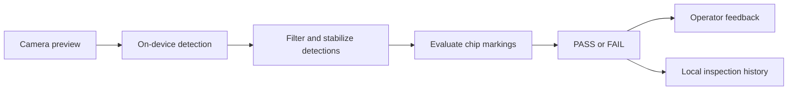

# Chipvel

**Automated chip inspection by Harvel Systems**

Chipvel is an Android application for camera-based inspection of electronic chips in a conveyor workflow. It uses an on-device TensorFlow Lite model to detect chips and their markings, applies inspection rules, and presents clear **PASS** or **FAIL** results to the operator.

## Features

- **Live inspection:** Camera preview with chip and marking overlays.
- **Inspection region:** Configure the region of the camera image used for inspection.
- **Stable-scene checks:** Wait for the camera view to settle before evaluating a scene.
- **Operator feedback:** Display PASS/FAIL results and optionally play buzzer and voice announcements.
- **Inspection history:** Review saved inspections and their results on the device.
- **Settings:** Configure the inspection region, stability behavior, and audio options.
- **Diagnostics:** Check model availability and view inspection performance information.
- **Simulation mode:** Exercise the inspection workflow when a live conveyor or camera scene is unavailable. Simulation is for workflow checks and does not replace live model inspection.

## How inspection works

The live camera feed is analyzed by the bundled model. Chip and marking detections are filtered and evaluated against the inspection rules. The app then shows the result, updates the inspection overlay, and saves the inspection for later review.



## Main screens

| Screen | Purpose |
| --- | --- |
| **Home** | Check system readiness, start an inspection, view summary counts, and read about Harvel Systems. |
| **Live Inspection** | View the camera feed and overlays, monitor inspection status, and start, stop, or resume a session. |
| **History** | Browse saved inspections, filter results, and open record details. |
| **Settings** | Set the inspection region and configure stability, sound, voice, and simulation options. |
| **Diagnostics** | Review model loading status and inspection performance information. |

## Technology

- **Kotlin** - application language
- **Jetpack Compose** and **Material 3** - user interface
- **CameraX** - camera preview and image analysis
- **TensorFlow Lite** - on-device chip and marking detection
- **Room** - local inspection records
- **DataStore** - persisted application settings
- **Kotlin Coroutines** - asynchronous work

## Requirements

- Android Studio with Android SDK 36
- JDK 17
- Android 7.0 (API 24) or newer
- Camera access for live inspection

## Getting started

1. Open the project in Android Studio and allow Gradle to sync.
2. Select the `app` run configuration.
3. Connect an Android device or start an emulator running Android 7.0 or newer.
4. Run the app and grant camera permission when prompted.

The inspection model is included in the repository at:

```text
app/src/main/assets/chipwell_yolo26n.tflite
```

Keep this asset in place for model loading and live inspection.

## Build and test

Build a debug APK from PowerShell:

```powershell
.\gradlew.bat :app:assembleDebug
```

On macOS or Linux, use:

```bash
./gradlew :app:assembleDebug
```

Run the Android unit tests from PowerShell:

```powershell
.\gradlew.bat :app:testDebugUnitTest
```

The debug APK is written under `app/build/outputs/apk/debug/`.

## Project structure

```text
app/src/main/
|-- assets/       Bundled inspection model
|-- java/         Android application source
|   `-- ...
`-- res/          App icon, splash screen, and UI resources
```

Within the application source, camera, inference, inspection workflow, tracking, local data, audio, and Compose UI code are grouped by responsibility.

## About Harvel Systems

Harvel Systems is an ISO 9001:2015-certified technology services organization focused on embedded hardware and software turnkey design. Its work spans industrial automation, medical technology, and embedded computing, with services that include hardware and FPGA design, software development, system design, test and prototyping, ODM, enclosure CAD, and onsite engineering support.

Harvel also supports new product design, redesign, and reverse engineering, with a focus on timely delivery, quality, and continual improvement.
